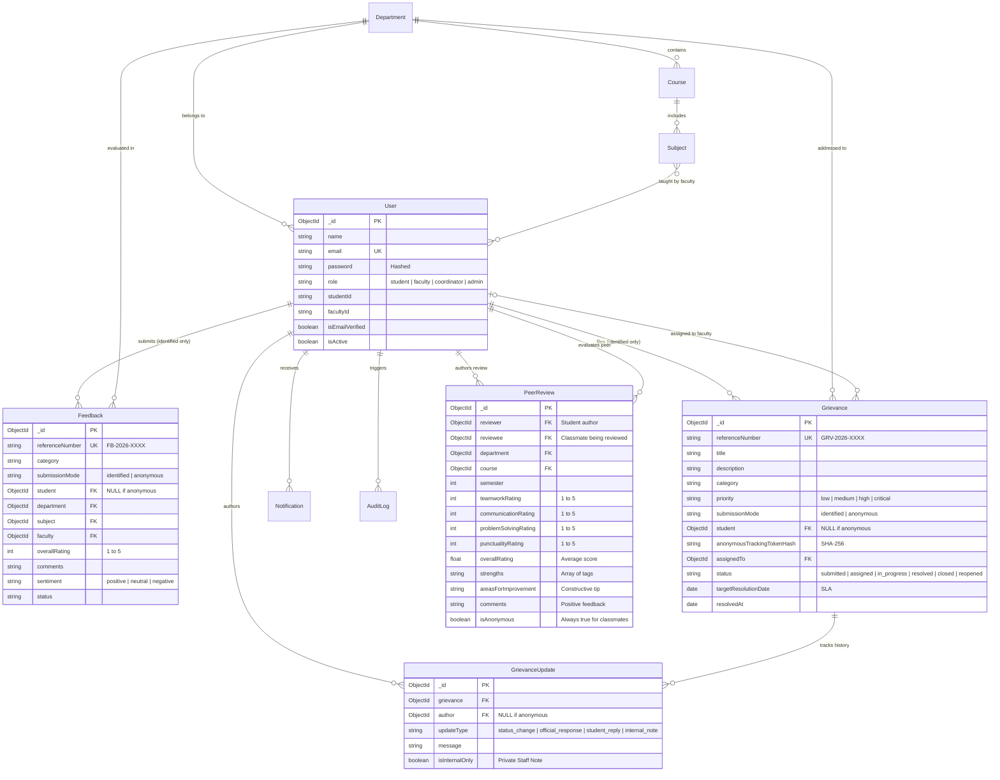

<<<<<<< HEAD
# SUVIDHA
=======
# SUVIDHA — Student Feedback & Grievance Management System
> **"Your Voice. Your Campus. Your Suvidha."**

A functional, secure, production-style full-stack web application designed for student feedback collection, anonymous evaluations, campus problem reporting, and SLA-tracked grievance redressal.

**Project Type:** 7th-Semester B.Tech Computer Science & Engineering Capstone Project  
**Technology Stack:** React 18, Vite, TypeScript, Tailwind CSS, Node.js, Express.js, MongoDB / Mongoose, Recharts, Vitest

---

## 1. Project Overview & Architecture

SUVIDHA eliminates traditional academic hierarchy barriers and retaliation fears by empowering students with **true privacy choices** alongside transparent administrative accountability. 

```
┌────────────────────────────────────────────────────────────────────────┐
│                        SUVIDHA CLIENT (React + Vite)                   │
│   Landing Page • Student Dashboard • Faculty Portal • Admin Center     │
│       Multi-Step Forms • Recharts Visualizations • Hindi/EN i18n       │
└────────────────────────────────────┬───────────────────────────────────┘
                                     │ HTTPS / REST API / HttpOnly Cookies
┌────────────────────────────────────▼───────────────────────────────────┐
│                     SUVIDHA BACKEND API (Express + TS)                 │
│  Rate Limiting • Helmet Headers • JWT Auth & Refresh Rotation          │
│  Role Authorization Middleware • Audit Event Logger • SLA Calculator  │
└────────────────────────────────────┬───────────────────────────────────┘
                                     │ Mongoose ODM
┌────────────────────────────────────▼───────────────────────────────────┐
│                     DATABASE LAYER (MongoDB Atlas / Local)             │
│  Zero-Config Auto Fallback to MongoMemoryServer in Local Dev           │
│  Strict Anonymous Decoupling (`student: null`, SHA-256 Tracking Hash)  │
└────────────────────────────────────────────────────────────────────────┘
```

---

## 2. Role-Based Access Control (RBAC) Matrix

| Feature / Operation | Student | Faculty | Coordinator | Administrator |
| :--- | :---: | :---: | :---: | :---: |
| Submit Identified Academic Feedback | ✅ | ❌ | ❌ | ❌ |
| Submit 100% Anonymous Feedback | ✅ (Unlinked) | ❌ | ❌ | ❌ |
| Track Identified Submissions in History | ✅ | ❌ | ❌ | ❌ |
| Track Anonymous Ticket with 32-char Token | ✅ (Public) | ✅ (Public) | ✅ (Public) | ✅ (Public) |
| Reopen Resolved Grievance | ✅ | ❌ | ❌ | ❌ |
| View Assigned Grievances | ❌ | ✅ | ✅ | ✅ |
| Update Status & Post Official Responses | ❌ | ✅ | ✅ | ✅ |
| Add Private Internal Staff Notes | ❌ | ✅ | ✅ | ✅ |
| View Course Evaluation Trends (>= Sample Threshold) | ❌ | ✅ | ✅ | ✅ |
| Triage & Assign Grievances to Staff | ❌ | ❌ | ✅ (Dept) | ✅ (Campus) |
| Manage Departments, Courses & Subjects | ❌ | ❌ | ✅ (Dept) | ✅ (Campus) |
| Manage Users & Deactivate Accounts | ❌ | ❌ | ❌ | ✅ |
| View Immutable Security Audit Logs | ❌ | ❌ | ❌ | ✅ |
| Export Sanitized CSV Reports | ❌ | ❌ | ✅ | ✅ |

---

## 3. Database Entity Relationship (ER) Diagram



---

## 4. Key Privacy & Security Implementations

1. **Cryptographic Anonymity Decoupling**:
   - For anonymous submissions, the database schema records `student: null`. There is no stored foreign key or relational reference linking the user's account to the feedback record.
   - For anonymous grievances, an unguessable 32-character token is returned to the user, and only its **SHA-256 hash** is persisted. Public status lookups query by hashed token, shielding the submitter's identity from staff and administrators.
2. **Small Class-Size Masking**:
   - Course feedback dashboards enforce a statistical privacy threshold: individual reviews and rating breakdowns are masked until at least 2 to 3 evaluations are collected, preventing faculty from deanonymizing respondents in small elective classes.
3. **Sensitive Complaint Quarantine**:
   - Grievances categorized under *Harassment or Serious Misconduct* are tagged `isSensitive: true`. They bypass general faculty accounts and are routed exclusively to the designated Internal Complaints Committee (ICC).
4. **Session Security & Token Rotation**:
   - Passwords hashed using `bcrypt` (10 salt rounds).
   - JWT Access tokens (15-min expiry) paired with Refresh tokens (7-day expiry) with cryptographic rotation and session revocation support in HttpOnly, SameSite cookies.
5. **Quality & Duplicate Controls**:
   - Real-time debounced duplicate detection flags existing campus maintenance tickets to prevent redundant filings.
   - Input sanitization and strict server-side validation via `Zod`.
   - Rate limiting on sensitive endpoints via `express-rate-limit`.
6. **Classmate Peer Review & 360° Feedback System (Double-Blind Anonymity)**:
   - Any student of a class section can evaluate their classmates across 4 core competencies: *Teamwork & Collaboration*, *Communication & Listening*, *Technical Problem Solving*, and *Punctuality & Reliability*.
   - Students can endorse strengths (`Great Leader`, `Quick Problem Solver`, `Technically Strong`, etc.) and leave constructive growth advice.
   - **Double-Blind Privacy Guarantee**: When a student opens their **My Peer Feedback (360° Report)**, they view an interactive Recharts Competency Radar chart, overall ratings, and an anonymous feedback wall. All reviewer references are strictly removed at the database projection level to prevent peer bias and ensure psychological safety.
   - **Self-Review Prevention**: The backend rejects self-reviews with a 400 validation error, and enforces a unique compound index per semester.

---

## 5. Pre-Seeded Demo Accounts for Evaluation

The database seed script initializes realistic test accounts across all roles:

| Role | Email | Password | Details |
| :--- | :--- | :--- | :--- |
| **Student (Identified)** | `aarav.sharma@suvidha.edu` | `Student@12345` | Aarav Sharma (7th Sem B.Tech CSE) |
| **Student 2** | `diya.patel@suvidha.edu` | `Student@12345` | Diya Patel (7th Sem B.Tech CSE) |
| **Faculty Member** | `faculty.verma@suvidha.edu` | `Faculty@12345` | Dr. Ramesh Verma (Operating Systems) |
| **Department Coordinator** | `coordinator.cse@suvidha.edu` | `Faculty@12345` | Dr. Ananya Mukherjee (CSE Coordinator) |
| **Campus Administrator** | `admin@suvidha.edu` | `Admin@12345` | Prof. Rajeshwar Sen (System Lead) |

> **Anonymous Grievance Demo Token:** `trk_demo_token_1234567890abcdef`  
> Enter this token on the `/track` page to inspect anonymous ticket tracking!

---

## 6. Installation & Execution Guide

### Prerequisites
- Node.js (v18 or higher)
- npm (v9 or higher)

### Quick Setup

1. **Install All Dependencies:**
   ```bash
   # From root directory:
   npm run install:all
   ```

2. **Database Configuration:**
   The backend comes pre-configured with **zero-config automatic fallback**:
   - If an external MongoDB instance is running at `mongodb://localhost:27017/suvidha` (or MongoDB Atlas URI in `backend/.env`), it will connect directly.
   - If no MongoDB instance is running, it **automatically launches an embedded in-memory MongoDB** (`mongodb-memory-server`) and auto-seeds demo data! Zero setup required.

3. **Seed Database Manually (Optional):**
   ```bash
   cd backend
   npm run seed
   ```

4. **Start Backend & Frontend Servers:**
   ```bash
   # In terminal 1 (Backend API on port 5000):
   cd backend
   npm run dev

   # In terminal 2 (Frontend Client on port 3000):
   cd frontend
   npm run dev
   ```

5. **Open Application in Browser:**
   Visit: `http://localhost:3000`

---

## 7. Running Automated Tests

```bash
# Run Backend API & Security Tests:
cd backend
npm test

# Run Frontend React Component Tests:
cd frontend
npm test
```

---

## 8. College Project Evaluation Demonstration Flow

For presenting this project to external examiners or faculty reviewers, follow this recommended walkthrough:

1. **Landing Page Tour (`/`):**
   - Showcase modern university aesthetic, emergency helpline disclaimer, How-It-Works workflow, and interactive FAQ accordion.
   - Toggle **Dark Mode / Light Mode** and **English / Hindi Interface**.
2. **Student Experience:**
   - Click "Student Login" -> use the 1-click **Autofill Student** button.
   - View personalized dashboard metrics, announcements banner, and recent submissions.
   - Navigate to **Give Feedback** -> complete the 5-step guided form with ratings, criteria, and draft auto-save.
   - Navigate to **Report Issue** -> type "FPGA Lab kit" to demonstrate **Duplicate Issue Detection**. Choose **Anonymous Grievance** to generate a 32-character tracking token.
   - Navigate to **Peer Review (360°)** (`/peer-review`):
     - **Review Classmates Tab**: View class section progress (e.g. 2 / 9 evaluated), search classmates, and click "Submit Review" on any classmate (e.g. Vikram Singh). Rate them across 4 competencies (Teamwork, Communication, Problem Solving, Punctuality), endorse positive strengths, and submit.
     - **My Peer Feedback Tab**: Inspect the interactive **360° Competency Radar Chart**, average trait scores (e.g. ⭐ 4.6 / 5.0), top strength badges (`Great Leader ×3`, `Quick Problem Solver ×2`), and the **Anonymous Constructive Feedback Wall** with genuine compliments and tips for growth from classmates.
3. **Anonymous Tracking Portal (`/track`):**
   - Enter the generated tracking token (or click the demo token `trk_demo_token_1234567890abcdef`).
   - Show how updates are tracked with complete anonymity, and submit a reply.
4. **Faculty Dashboard (`faculty.verma@suvidha.edu`):**
   - Log in as faculty member.
   - View assigned grievances with SLA status countdowns.
   - Post an official response and update status to *In Progress*.
   - View Course Feedback with the **Sample Size Privacy Guard** active.
5. **Coordinator / Administrator Command Center (`admin@suvidha.edu`):**
   - View live database charts: Monthly submissions, Category breakdown, Department comparisons, and **Smart Feedback Insights** (recurring campus themes).
   - Triage grievances, assign to faculty, and set custom SLA deadlines.
   - Manage user accounts (toggle active/disabled, role changes).
   - Inspect **Security Audit Logs** and download **Sanitized CSV Reports**.
>>>>>>> b3c2f02 (feat: Complete SUVIDHA Student Feedback and Grievance Management System)
